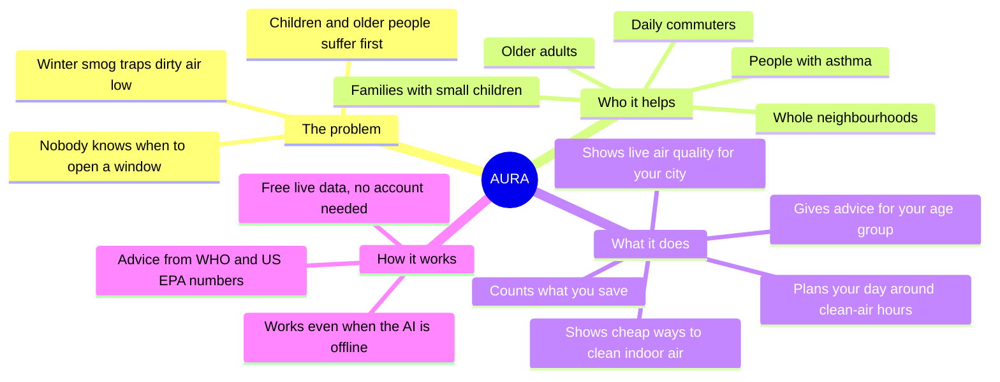
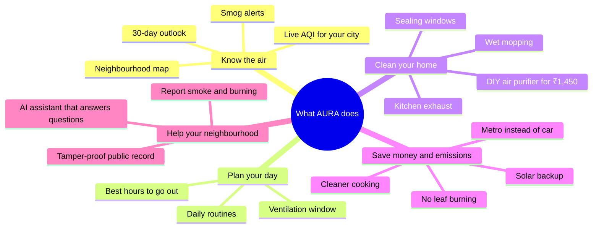

# AURA — The Urban Air Quality Assistant

**Smog is hard to see. AURA tells your family what the air is doing today, and what to do about it.**

Try it live: **[auratheairqualityassistant.vercel.app](https://auratheairqualityassistant.vercel.app/)**

[](https://github.com/AkshithKheeran-ISE/AURA-promptwars-/actions/workflows/ci.yml)
[](https://auratheairqualityassistant.vercel.app/)

---

## The idea in 30 seconds

Winter smog traps dirty air close to the ground. Families still have to live their day: send children to school, go to work, cook dinner, sleep.

AURA answers three simple questions, every day:

1. **How bad is the air right now, where I live?**
2. **What should my family do today?**
3. **Is it working?** (Less smoke breathed in. Less money spent. Less pollution made.)

That is the whole idea. Everything in this app exists to answer those three questions.

---

## The idea as a mind map



---

## What happens when you open AURA


1. **Pick your city.** Type any city in the world. AURA fetches its live air quality, free, no sign-up.
2. **See the live air.** One big number (the AQI), the PM2.5 level, and a plain answer: open the windows, open them briefly, or keep the house sealed.
3. **Pick who you are.** Infant, schoolchild, teenager, adult, older adult — plus toggles for asthma, heart or lung conditions, and pregnancy. The same air means different things for different people, so the advice changes.
4. **Get your day's plan.** The best hours to go out, when to ventilate the house, and what to avoid.
5. **See what you saved.** Cleaner air breathed, money saved, emissions avoided — in plain numbers.

---

## Everything in the app, in one more mind map



Ten pages in the app, but they all fit under those five branches. If a feature does not fit one of them, it does not belong in AURA.

---

## Advice that changes with age

The same PM2.5 number is not the same risk for everyone. Children breathe faster. Older lungs are weaker. So AURA judges the air one step stricter for the people who need it most.

| Who                             | What changes                                              |
| ------------------------------- | --------------------------------------------------------- |
| Infants (0–5)                   | Strictest advice. Tiny lungs, fast breathing.             |
| Schoolchildren (6–12)           | Strict advice. Still growing, lots of outdoor play.       |
| Teenagers (13–17)               | Strict advice. The EPA counts under-18s as sensitive.     |
| Adults (18–59)                  | Standard advice.                                          |
| Older adults (60+)              | Strict advice. Weaker lungs, more heart and lung disease. |
| Asthma, heart or lung condition | Advice gets one step stricter, at any age.                |
| Pregnant                        | Advice gets one step stricter.                            |

Each answer tells you three things: how long to stay outdoors, whether to wear a fitted N95 mask, and why — in plain words, with the WHO number it is compared against.

---

## Where the numbers come from

| What                    | Where it comes from                                                            |
| ----------------------- | ------------------------------------------------------------------------------ |
| Live air quality        | Open-Meteo / CAMS — free, no key, no account                                   |
| City search             | Open-Meteo Geocoding — free, no key                                            |
| Weather and smog height | Open-Meteo Weather — free, no key                                              |
| AI answers              | Google Gemini through a server-side proxy (the key never reaches your browser) |
| Health numbers          | WHO 2021 guidelines and US EPA 2024 bands                                      |

**Live vs the rest, honestly:** the big number on the home page is live data for your city. Some older pages still show Delhi's official baseline and computer simulations — the app labels those clearly, so live data is never dressed up as something it is not.

---

## Honest notes

- **This is guidance, not medical advice.** If someone is struggling to breathe, see a doctor.
- **The live PM2.5 is an hourly reading.** The WHO target and EPA bands it is compared with are 24-hour averages. The app says so on the screen.
- **Outdoor-time minutes are AURA's own guidance.** The EPA only says "shorter and less intense, with more breaks" — it gives no minute values.
- **No authority publishes per-age AQI breakpoints.** AURA does not invent any. It applies the EPA's sensitive-groups idea: children, teenagers, older adults, and people with heart or lung disease feel the effects one band earlier.
- **Offline, there is no live data.** The AI falls back to built-in expert advice, and the live panel says clearly that it is offline.

---

## What's new in this version

- **Age-wise guidance.** Five age groups plus asthma and pregnancy toggles, all driven by the live reading.
- **Better code, same app.** Cleaner structure, no shortcuts in the live-data code, shared helpers instead of repeated code.
- **Safer.** Inputs are cleaned on both sides, the AI key stays on the server, and security scans run on every push.
- **Faster.** Pages load on demand, live data is cached for 10 minutes, and files are cached for a year.
- **Easier to use for everyone.** Keyboard friendly, screen-reader friendly, and checked by automated accessibility scans on every page.

---

## For developers

```bash
npm install   # install
npm run dev   # run locally
npm test      # run the tests
npm run build # production build
```

Health of the project, in one line: **430 tests passing, 43 suites. Coverage: 97.87% lines, 91.38% branches, 96.85% functions.** CI runs lint, typecheck, format, tests, audit, build, and Playwright end-to-end tests on every push.

---

## License

MIT. Made for families living through winter smog.
